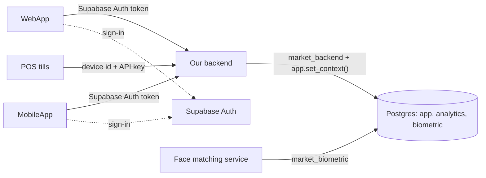
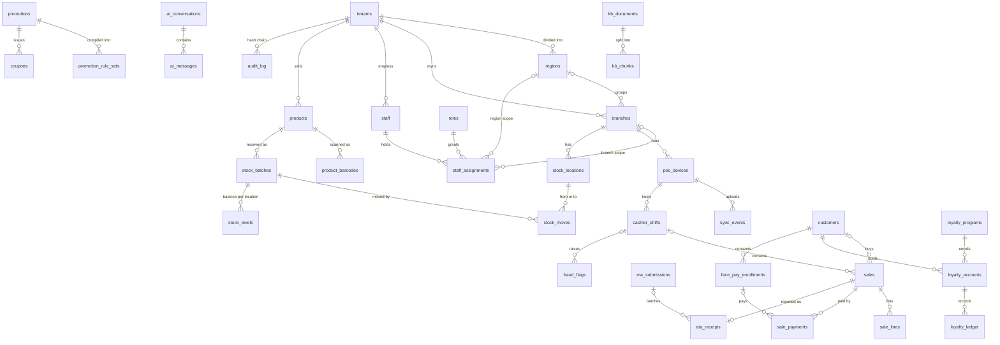

# Market SaaS database

The PostgreSQL schema for the Retail SaaS Platform & Distributed Edge POS. It is built for
Supabase (project `vtvvyykyyorsbkfitlur`). The design and its reasoning are in
[`docs/superpowers/specs/2026-10-11-supabase-database-design.md`](../docs/superpowers/specs/2026-10-11-supabase-database-design.md).

The WebApp and the MobileApp never query the database themselves. They sign users in with
Supabase Auth and call **our own backend**, and only the backend connects to Postgres, as the
role `market_backend`. Supabase's Data API is not used for these tables: the `app`, `analytics`
and `biometric` schemas are not exposed, and the API roles `anon` and `authenticated` have no
access to them.



## Roles

| Role | Logs in | Used by | Reaches |
|---|---|---|---|
| `market_backend` | yes | the backend's connection pool | `app` tables through row level security; every transaction starts with `app.set_context(...)` |
| `market_ai_reader` | no | the backend, for LLM-generated SQL (`set local role market_ai_reader`) | the `analytics` views only, still filtered by the request context |
| `market_analytics_owner` | no | nobody: it owns the `analytics` views | — |
| `market_biometric` | yes | the face-matching service | `biometric.face_templates` and its two functions |

The migrations create all four roles without login. No password is stored in this repository.

## Applying to Supabase

1. **Rotate the database password first.** The `postgres` password was shared in a chat. Reset
   it in the dashboard under Database → Settings.
2. Push the migrations with the Supabase CLI:

   ```bash
   supabase login
   supabase link --project-ref vtvvyykyyorsbkfitlur
   supabase db push      # applies supabase/migrations in order
   ```

   `supabase/seed.sql` is demo data: two canary markets, their staff, and tills whose API keys
   are in this repository. `supabase db reset` loads it into a local stack. Load it only into
   local or throwaway databases.
3. Give the two login roles passwords. Do this by hand in the SQL editor, never in a migration:

   ```sql
   alter role market_backend   with login password '<long random password>';
   alter role market_biometric with login password '<another long random password>';
   ```

   Generate each one with, for example, `openssl rand -base64 32`, and keep it in your secret
   store or a git-ignored `.env`.
4. Build the connection string from the dashboard's **Connect** dialog, replacing the user:
   - Direct connection (IPv6, or IPv4 with the add-on):
     `postgresql://market_backend:<password>@db.vtvvyykyyorsbkfitlur.supabase.co:5432/postgres`
   - Supavisor pooler (IPv4): the pooler user is `<role>.<project-ref>`, the same pattern as
     the dashboard's `postgres.<project-ref>`:
     `postgres://market_backend.vtvvyykyyorsbkfitlur:<password>@aws-<region>.pooler.supabase.com:5432/postgres`
     for session mode, or port `6543` for transaction mode. Transaction mode does not support
     prepared statements, so turn them off in your driver (see the Python example).

   All of these work with the contract below, because the request context only lives inside
   one transaction.
5. Check the setup as `market_backend`:
   `select * from app.staff_memberships('<a Supabase Auth user id>');`

## Backend connection contract

1. **One request, one transaction.** Begin, call `app.set_context(...)` first, run the
   request's queries, then commit. The context is set with `set_config(..., true)`, so it ends
   at commit or rollback and cannot leak into the next request on a pooled connection.
2. **No context means no data.** Row level security fails closed. If `set_context` is missing
   or wrong, reads return no rows and inserts fail with a row-level-security error. They never
   return another market's data. When an endpoint "has no data", check its context first.
3. **`set_context` validates its arguments.** The tenant must be active and the staff member
   an active member of it. The device must be an active device of the tenant, and its branch
   becomes the context's branch. The branch must belong to the tenant, and the customer must
   exist. Anything else raises SQLSTATE `42501`.
4. **The right context for each caller:**

   | Caller | `set_context` arguments | Reach |
   |---|---|---|
   | Staff on the WebApp | `p_tenant_id`, `p_staff_id`, optionally `p_branch_id` to narrow | branches from their assignments: owner = whole tenant, regional manager = their region, branch staff = their branch |
   | Cashier at a till | `p_tenant_id`, `p_device_id`, `p_staff_id` | the till's branch only |
   | A till syncing on its own | `p_tenant_id`, `p_device_id` | the till's branch |
   | Shopper in one market's storefront | `p_tenant_id`, `p_customer_id` | their own sales, loyalty and coupons in that market, plus what it shows every shopper (products, branches, running promotions, published public help articles) |
   | Shopper's "my account" across markets | `p_customer_id` | their own rows in every market |
   | Background job (forecasting, ETA submitter, …) | `p_tenant_id`, `p_system_actor => 'forecast_job'` | the whole tenant |

5. **Before a context exists**, resolve identities with these lookups:
   - `app.staff_memberships(auth_user_id)` returns `(staff_id, tenant_id, tenant_name)` for a
     signed-in staff user. Choose the tenant, then set the context.
   - `app.customer_id_for_auth_user(auth_user_id)` returns the shopper's customer id.
   - `app.register_customer(full_name, phone, email, auth_user_id, language)` finds or creates
     the shopper. Verify the phone with an OTP before linking an existing phone number to an
     app account.
   - `app.authenticate_device(device_id, api_key)` returns `(tenant_id, branch_id)` of an
     active till. The database stores only the SHA-256 of the key.
   - `app.provision_tenant(name, owner_full_name, owner_auth_user_id, owner_email, language)`
     signs up a new market with its owner.

   `auth_user_id` is the `sub` claim of the Supabase Auth access token. Verify the token's
   signature in the backend before trusting it; Supabase's
   [JWT guide](https://supabase.com/docs/guides/auth/jwts) shows how.
6. **Till uploads are idempotent.** POS events go into `app.sync_events`. Each event's `id` is
   the UUID the till generated, and each till numbers its events with `sequence_no`. Insert with
   `on conflict (id) do nothing` so a retry never duplicates an event.
7. **Pass embeddings as parameters.** Send a vector as its text form, for example
   `'[0.12,-0.03,…]'`, in a query parameter without a cast. The app roles may have no access to
   the `extensions` schema, so `$2::extensions.vector` can fail where
   `app.kb_hybrid_search($1, $2, 8)` works.
8. **Run LLM-generated SQL in its own read-only transaction**, and accept only a single
   `SELECT` statement from the model:

   ```sql
   begin read only;
   select app.set_context(p_tenant_id => $1, p_staff_id => $2);
   set local role market_ai_reader;
   set local statement_timeout = '5s';
   -- the generated SELECT over analytics.* runs here
   commit;
   ```

   `market_ai_reader` sees only `analytics.sales_daily`, `analytics.product_sales_daily` and
   `analytics.stock_on_hand`, and it cannot call `set_context`.

### Node.js (pg)

```js
import pg from 'pg';

// DATABASE_URL: market_backend through the pooler or the direct endpoint, kept in .env
const pool = new pg.Pool({ connectionString: process.env.DATABASE_URL });

export async function withContext(ctx, work) {
  const client = await pool.connect();
  try {
    await client.query('begin');
    await client.query(
      `select app.set_context(p_tenant_id => $1, p_staff_id => $2, p_branch_id => $3,
                              p_device_id => $4, p_customer_id => $5, p_system_actor => $6)`,
      [ctx.tenantId ?? null, ctx.staffId ?? null, ctx.branchId ?? null,
       ctx.deviceId ?? null, ctx.customerId ?? null, ctx.systemActor ?? null],
    );
    const result = await work(client);
    await client.query('commit');
    return result;
  } catch (error) {
    await client.query('rollback');
    throw error;
  } finally {
    client.release();
  }
}

// A cashier at a till
const { rows } = await withContext(
  { tenantId, deviceId, staffId },
  (db) => db.query('select id, grand_total, occurred_at from app.sales order by occurred_at desc limit 20'),
);
```

node-postgres sends parameterised queries as unnamed statements, which every pooler mode
accepts.

### Python (psycopg 3)

```python
import os
from psycopg_pool import ConnectionPool

# autocommit=True lets conn.transaction() issue a real BEGIN/COMMIT;
# prepare_threshold=None keeps psycopg from preparing statements (the transaction pooler rejects them).
pool = ConnectionPool(os.environ["DATABASE_URL"], open=True,
                      kwargs={"autocommit": True, "prepare_threshold": None})

SET_CONTEXT = """
    select app.set_context(p_tenant_id => %(tenant_id)s, p_staff_id => %(staff_id)s,
                           p_branch_id => %(branch_id)s, p_device_id => %(device_id)s,
                           p_customer_id => %(customer_id)s, p_system_actor => %(system_actor)s)
"""
CONTEXT_KEYS = ("tenant_id", "staff_id", "branch_id", "device_id", "customer_id", "system_actor")


def with_context(ctx, work):
    with pool.connection() as conn, conn.transaction():
        conn.execute(SET_CONTEXT, {key: ctx.get(key) for key in CONTEXT_KEYS})
        return work(conn)


# A shopper in one market's storefront
balances = with_context(
    {"tenant_id": tenant_id, "customer_id": customer_id},
    lambda conn: conn.execute("select points from app.loyalty_balances").fetchall(),
)
```

## Schema map

| Migration | What it adds |
|---|---|
| `20261011120000_foundation` | schemas `app`, `analytics` and `biometric`; pgvector; the four roles; the context readers `app.current_*()`; shared trigger helpers |
| `20261011120100_core_tenancy` | tenants → regions → branches; staff, roles and permissions; staff assignments scoped to a tenant, region or branch; customers and tokenised payment methods; POS devices and their secrets; `set_context`, `accessible_branch_ids`, `has_permission` and the identity lookups |
| `20261011120200_catalog` | categories, products (including weighed items), GS1 barcodes, branch price overrides, `effective_price` |
| `20261011120300_inventory` | stock locations, suppliers, batches with expiry dates, transfers (with a 48-hour transit expiry guard), purchase orders, the append-only double-entry `stock_moves` ledger, the derived `stock_levels`, `fefo_pick`, `stock_discrepancies` |
| `20261011120400_promotions` | ten promotion mechanics, branch targeting, compiled rule sets with checksums, coupons |
| `20261011120500_sales` | cashier shifts, the `sync_events` inbox, sales, sale lines, payments and discounts (lines and discounts are append-only) |
| `20261011120600_loyalty` | loyalty programs and accounts, the append-only points ledger, `loyalty_balances` |
| `20261011120700_eta_receipts` | the ETA e-receipt chain per till, submissions (at most 500 receipts or 1.5 MB), `eta_overdue_receipts` |
| `20261011120800_audit_loss_prevention` | the SHA-256 hash-chained `audit_log`, one chain per tenant (`append_audit`, `verify_audit_chain`); fraud flags and `detect_shift_exceptions` |
| `20261011120900_forecasting` | demand forecasts with quantiles, dynamic reorder points |
| `20261011121000_ai_assistant` | AI conversations and messages (the structured JSON answer in `ai_messages.response`); knowledge-base documents and chunks (Arabic and English full text plus 1024-dimension embeddings); `kb_hybrid_search` |
| `20261011121100_face_pay` | consented Face Pay enrollments and `resolve_face_pay`; 128-dimension face templates in `biometric`, with `match_face` and `delete_subject` |
| `20261011121200_analytics` | governed views for NL-to-SQL: `sales_daily`, `product_sales_daily`, `stock_on_hand` |

Every assistant message stores its structured output in `app.ai_messages.response`. It must be
a JSON object with a string `answer`, and `citations`, when present, must be an array:

```json
{
  "answer": "Net revenue fell 12% week on week.",
  "citations": [{"chunk_id": "…", "document_id": "…", "quote": "…"}],
  "sql": "select sales_date, net_revenue from analytics.sales_daily …",
  "result": {"columns": ["sales_date", "net_revenue"], "rows": [["2026-10-04", 36900.00]]},
  "chart": {"type": "line", "x": "sales_date", "series": ["net_revenue"]},
  "abstained": false
}
```

## ER overview

The main entities only. Tables owned by a market carry `tenant_id`, and their foreign keys
include it, so a row can never point into another market. Customers are global: one shopper
account works across every market.



## Tests

```bash
PGPASSWORD=... scripts/db-test.sh            # rebuild market_saas_test and run every pgTAP file
PGPASSWORD=... scripts/db-test.sh supabase/tests/database/050_inventory_ledger.test.sql   # one file
PGPASSWORD=... scripts/db-test-nonsuper.sh   # migrate as a non-superuser, like Supabase's postgres
```

The scripts need PostgreSQL 16 or later with pgvector and pgTAP, plus `pg_prove`. On Ubuntu that
is `postgresql-16-pgvector postgresql-16-pgtap libtap-parser-sourcehandler-pgtap-perl`. They
connect with the usual libpq variables. `scripts/sql/supabase-compat.sql` adds what every
Supabase project already has: the API roles and the `extensions` schema.

| File | Covers |
|---|---|
| `010_security_baseline` | schemas, roles and grants; the API roles are locked out |
| `020_tenant_isolation`, `021_context_autocommit` | tenants never see each other; the context dies with its transaction |
| `030_hierarchy_rbac` | owner, regional manager and branch reach; branch-scoped permissions |
| `040_catalog` | products, GS1 barcodes, branch prices |
| `050_inventory_ledger` | double-entry stock moves, derived levels, FEFO, the transit expiry guard |
| `060_promotions` | mechanics, targeting, rule-set checksums, coupons |
| `070_sales_sync` | idempotent sync, sale arithmetic, payments |
| `080_loyalty` | points ledger, storefront and cross-market shopper paths |
| `090_eta_receipts` | receipt chain, buyer rules, the return window, submissions |
| `100_audit_chain` | the hash chain and tamper detection |
| `110_loss_prevention` | the five exception rules and their thresholds |
| `120_ai_assistant` | JSON responses, audience isolation, hybrid search |
| `130_face_pay` | separated templates, matching threshold, limits, erasure |
| `140_analytics` | the semantic layer under the caller's reach |

The seed's canary markets, *Alpha Mini Market* and *Nile Hypermarket*, use readable fixed UUIDs
so that tests can name rows directly. The pattern is `TTTTTTTT-EEEE-0000-0000-00000000000N`:
the tenant prefix is `aaaaaaaa` or `bbbbbbbb` (customers use `cccccccc`), and the entity code is
`0000` tenant, `0001` region, `0002` branch, `0003` staff, `0004` device, `0005` product and so on.

## Security notes

- Rotate the `postgres` password (it was shared in a chat), and keep every password out of git.
  `.env` files are ignored.
- The apps hold only the Supabase URL and anon key (for Auth) and the backend's URL. They never
  hold the `service_role` key or a database password.
- Keep `app`, `analytics` and `biometric` out of the Data API's exposed schemas.
- Give the `market_biometric` credentials only to the face-matching service. An erasure request
  calls `biometric.delete_subject(token)` and revokes the enrollment.
